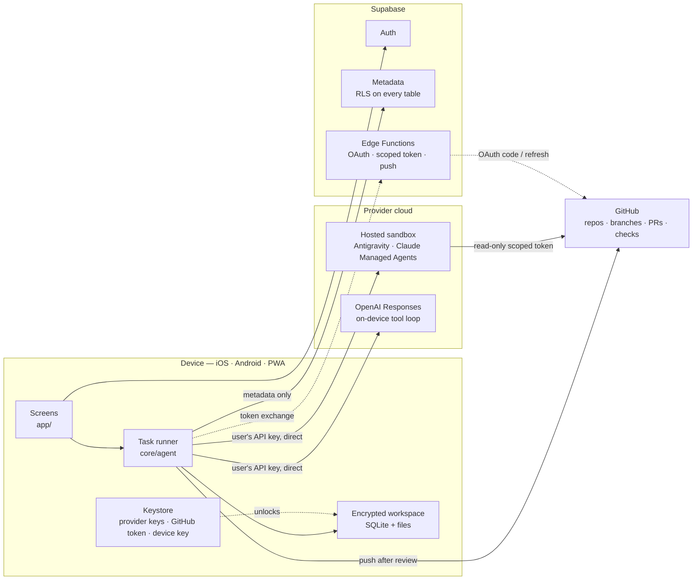

<p align="center">
  <picture>
    <source media="(prefers-color-scheme: dark)" srcset="assets/wordmark-light.png">
    
  </picture>
</p>

<p align="center">
  <strong>Run a coding agent on your repository from your phone, tablet or browser.<br>
  Review every change, push to GitHub, and watch the workspace erase itself.</strong>
</p>

<p align="center">
  <a href="https://expo.dev"></a>
  <a href="https://reactnative.dev"></a>
  <a href="https://www.typescriptlang.org"></a>
  <a href="https://supabase.com"></a>
  
  
</p>

<p align="center">
  <a href="https://vasavdotjs.github.io/halcyx-ai/"></a>
  <a href="https://github.com/VasavDotJS/halcyx-ai/actions/workflows/pages.yml"></a>
</p>

---

HALCYX is a mobile-first client for hosted coding agents. You point it at a GitHub repository, describe what you want,
and a sandboxed agent — Google Antigravity, Claude Managed Agents, or an OpenAI tool loop — does the work in the
provider's cloud. While it runs you can close the app; HALCYX polls the provider directly and notifies you when the
agent is finished or needs a decision.

When it is done, the changes arrive as an end-to-end encrypted, per-task workspace. You review them as a diff, file by
file or hunk by hunk, run a secret scan, and push to a fresh `halcyx/<task>` branch. There is no force-push code path.
Once GitHub confirms the push, the workspace key is destroyed.

**Your provider key never leaves the device.** Every model call goes directly from the app to the provider. The HALCYX
backend stores accounts, devices, preferences and task *metadata* only — never keys, source code, diffs or prompts.

- **Bring your own key** — Gemini, Anthropic or OpenAI, stored in the device keystore. No subscription, no proxy.
- **Hosted sandboxes** — agents keep working with the app closed, with a repo-scoped, read-only GitHub token.
- **Encrypted, expiring review** — AES-256-GCM per workspace, 72-hour default retention, crypto-shredded on push.
- **One codebase, four platforms** — iOS, iPadOS, Android and an installable PWA from Expo + React Native Web.
- **Decisions are documented** — every security-relevant choice and its reasoning lives in [`DECISIONS.md`](DECISIONS.md).

---

## Contents

1. [How it works](#how-it-works)
2. [Architecture](#architecture)
3. [Features](#features)
4. [Security and privacy model](#security-and-privacy-model)
5. [Tech stack](#tech-stack)
6. [Repository layout](#repository-layout)
7. [Getting started](#getting-started)
8. [Configuration](#configuration)
9. [Scripts](#scripts)
10. [Testing](#testing)
11. [Deployment](#deployment)
12. [Troubleshooting](#troubleshooting)
13. [Project status and known limitations](#project-status-and-known-limitations)
14. [Contributing](#contributing)
15. [License](#license)

---

## How it works

1. **Connect** — sign in with Apple, Google, GitHub, email + password, or a magic link. Install the GitHub App and
   choose which repositories HALCYX may see.
2. **Ask** — pick a repo and branch, choose a provider, model and effort, then describe the task. Attach a screenshot
   or dictate it on-device if you like.
3. **Run** — the agent works in a hosted sandbox with a token scoped to that one repository and `contents: read`.
   It cannot push, force-push, or open pull requests.
4. **Review** — the agent hands back `changes.tar`, `summary.md` and `checks.json` through a fixed contract. HALCYX
   verifies every path, ingests only real changes, seals them with the workspace key and renders a diff.
5. **Ship** — the pre-push scanner blocks anything that looks like a secret. Push uses the GitHub Git Data API
   (blobs → tree → commit → ref) with `force: false`; if the branch moved you are offered an agent rebase.
6. **Erase** — after the remote ref matches the pushed commit, the key is deleted first and the ciphertext after.

The whole loop is designed so the two things you cannot take back — a leaked key and a rewritten branch — are
structurally impossible rather than merely discouraged.

---

## Architecture



| Layer | Location | Responsibility |
| --- | --- | --- |
| Screens | `app/` | expo-router routes: auth, onboarding, chat, projects, review, settings |
| Domain | `core/` | providers, runner, workspace, GitHub, crypto, cleaner, usage, offline queue |
| Platform adapters | `core/platform/` | SQLite, files and secrets; `.web.ts` variants for the PWA |
| UI system | `ui/` | primitives, theming, diff view, timeline, preview frame |
| Client state | `state/`, `hooks/` | zustand stores, TanStack Query, lifecycle and stream hooks |
| Backend | `backend/supabase/` | schema, RLS, functions, cron, Edge Functions |
| Remote config | `config/models.json` | model catalogue seeded into `model_config` |

**Trust boundaries.** Provider keys, source code and workspace keys live on the device. Supabase receives metadata
only, enforced twice: a client-side allow-list (`core/backend/metadata.ts`) and a `looks_secret()` CHECK constraint on
every free-text column. GitHub user tokens are stored in the keystore; the one-time OAuth exchange and refresh in
`github-oauth` forwards them without persisting them.

---

## Features

| Area | What you get |
| --- | --- |
| **Agents** | Gemini Antigravity (remote environment), Claude Managed Agents (agent + environment per user, session per task), OpenAI Responses with an on-device tool loop and `store: false`. |
| **Control** | Per-task model and effort, live cost/speed estimate, stop / pause / follow-up, approvals for destructive steps, multi-agent compare across 2–3 models with separate workspaces and branch suffixes. |
| **Review** | Unified and split diffs, per-file and per-hunk accept/reject, file tree, AI summary, lint/test results from the sandbox, secret scan, large-file and CI gates. |
| **GitHub** | GitHub App OAuth with PKCE, repo and branch browsing, commit history, PRs, check runs, merge, rebase-on-conflict, branch naming `halcyx/<slug>` with `-2`, `-3` suffixes. |
| **Privacy** | Encrypted workspaces with AAD binding, retention 1 h–7 d (72 h default), expiry warnings, crypto-shred on push/expiry/discard, local-only wipe, device list with revocation. |
| **Usage** | On-device token and cost meter, budget alerts at a configurable percentage, a monthly cap that blocks new tasks and stops running ones at the next turn. |
| **Platform** | Five themes plus a custom accent, Dynamic Type, reduce-motion, tablet side rail and split review, keyboard shortcuts on web and hardware keyboards, haptics. |
| **Everywhere** | Offline review/history/settings, queued tasks that send when connectivity returns, on-device dictation, image attachments, local notifications, optional cross-device push and email digest. |
| **Extras** | Prompt library and slash commands, per-repo instructions, storage cleaner that never touches source or unpushed work, live preview with QR code, Sentry with scrubbing. |

---

## Security and privacy model

| Data | Lives in | Never sent to |
| --- | --- | --- |
| Provider API keys | Device keystore (`expo-secure-store`). On web, AES-GCM under a non-extractable WebCrypto key in IndexedDB | HALCYX backend, Sentry, logs, notifications |
| Source code, diffs, agent output | Encrypted workspace on device + the provider's sandbox | HALCYX backend, Sentry |
| GitHub user token | Device keystore | Backend storage (the exchange forwards it once, stores nothing) |
| Preferences, devices, task metadata | Supabase with RLS | — |

**Guarantees, and how they are enforced**

- **Crypto-shredding.** Each workspace has its own AES-256-GCM key. File contents and sensitive columns are sealed as
  `[version][iv][ciphertext]` with the workspace id and path as AAD, so a blob cannot be swapped between files. On
  destroy the key goes first; SQLite runs with `secure_delete = ON` as defence in depth.
- **No force-push.** The only ref update in `core/github/push.ts` uses `force: false`; a moved branch raises
  `RemoteMovedError` instead of overwriting.
- **Sandboxes are read-only.** `github-scoped-token` mints a token restricted to one repository with
  `contents: read, metadata: read`. Pushes always originate from the device after review.
- **Metadata only.** Supabase writes pass `assertMetadataOnly()` and the database re-checks every text column with
  `looks_secret()`. `tests/noSecretsToBackend.test.ts` covers both layers.
- **Crash safety.** A push writes an intent row before touching GitHub; on next launch HALCYX checks the remote and
  either completes the shred or returns the workspace to review.
- **Path safety.** Every path in the sandbox handoff is validated by `safeRepoPath()` — no `..`, no absolute paths, no
  `.git/`.

**Deliberate limits**

- Web key storage is weaker than a hardware keystore, and the app says so when you save a key in a browser. Treat a
  shared browser profile as trusted.
- On web, sensitive confirmations use the browser's dialog rather than WebAuthn. There is no hardware-backed
  authentication on the PWA today.
- OpenAI models run without a sandbox: they can read and write files and read the repo through the GitHub API, but
  cannot run tests or shell commands.
- Approval enforcement on Gemini is instructed via a custom tool; Anthropic enforces it at the platform level.
- The monthly cap is checked between turns, not mid-request, so the final turn of a task can slightly exceed it.

---

## Tech stack

| Concern | Choice |
| --- | --- |
| Runtime | Expo SDK 58, React Native 0.88, React 19 |
| Navigation | expo-router with typed routes |
| Language | TypeScript 5.9, `strict`, `noUncheckedIndexedAccess`, `noImplicitOverride` |
| Styling | NativeWind 4 + CSS-variable theme tokens, Geist / Geist Mono |
| Storage | expo-sqlite (wa-sqlite on web), expo-file-system, expo-secure-store, IndexedDB on web |
| Crypto | expo-crypto / WebCrypto, AES-256-GCM, HKDF-derived device and workspace keys |
| Server state | TanStack Query; zustand for local settings and session |
| Backend | Supabase: Auth, Postgres + RLS, Edge Functions (Deno), pg_cron |
| Git | GitHub App + Git Data API through typed `fetch` (no git binary, no Octokit in the workspace path) |
| Providers | Typed REST + SSE adapters — no vendor SDKs, one code path on all platforms |
| Observability | Optional Sentry with a shared scrubber; no analytics |
| Testing | Jest (Node + jest-expo projects), React Native Testing Library, Maestro |

---

## Repository layout

```
.
├── app/                     expo-router screens
│   ├── (auth)/              sign in, sign up, verify, forgot password
│   ├── (tabs)/              chat, projects, review, settings
│   ├── onboarding/          six-step first-run flow
│   ├── keys/[provider].tsx  key entry and validation
│   ├── preview.tsx          live preview + QR
│   └── _layout.tsx          providers, boot gate, app lock
├── core/
│   ├── agent/               runner, task store, timeline, background polling
│   ├── providers/           Gemini, Anthropic, OpenAI, handoff contract, SSE
│   ├── workspace/           encrypted store, tar ingest, diff, preflight, push flow
│   ├── github/              client, OAuth, repos, push, pulls, checks
│   ├── security/            crypto, key vault, biometrics, scanner, scrubber
│   ├── platform/            SQLite / files / secrets, native and web
│   ├── backend/             Supabase client, metadata allow-list, Edge Function calls
│   └── ...                  auth, cleaner, usage, offline, notifications, prompts
├── ui/                      primitives, themes, diff view, timeline, preview
├── state/                   zustand stores (session, settings)
├── hooks/                   lifecycle, auth bootstrap, keys, task stream, shortcuts
├── backend/supabase/        migrations, RLS, cron, five Edge Functions, local config
├── config/models.json       remote model catalogue (versioned)
├── public/                  PWA shell: index.html (CSP), manifest, service worker
├── scripts/                 web export post-processing: sub-path rebase, 404.html, .nojekyll
├── .github/workflows/       Pages deploy: typecheck, lint, tests, web export, publish
├── e2e/maestro/             five end-to-end flows
└── tests/                   unit, integration and UI tests
```

---

## Getting started

### Prerequisites

- Node.js 22 LTS and npm 10+
- A Supabase project and the Supabase CLI 2.x (`npm i -g supabase`)
- A GitHub account to register a GitHub App
- Xcode 17+ / Android Studio with SDK 36 for local native builds (EAS builds in the cloud)
- Optional: EAS CLI 16+, Maestro for E2E, a Sentry project, a Resend account for the digest

### 1. Install

```bash
git clone https://github.com/VasavDotJS/halcyx-ai.git
cd halcyx-ai
npm ci
```

### 2. Configure the app

```bash
cp .env.example .env
```

Fill in `EXPO_PUBLIC_SUPABASE_URL`, `EXPO_PUBLIC_SUPABASE_ANON_KEY`, `EXPO_PUBLIC_GITHUB_APP_CLIENT_ID` and
`EXPO_PUBLIC_GITHUB_APP_SLUG`. See [Configuration](#configuration) for every variable.

### 3. Set up Supabase

```bash
cd backend
supabase login
supabase link --project-ref <project-ref>

# Tables, RLS, SQL functions, digest cron, model catalogue seed
supabase db push

# Edge Function secrets, then deploy all five functions
supabase secrets set --env-file supabase/functions/.env
supabase functions deploy
```

In **Authentication ▸ Providers**, enable Email (confirmations on), Apple, Google and GitHub. Set the site URL to
`halcyx://` and add the redirect URLs `halcyx://auth-callback`, `halcyx://github-callback` and
`https://<your-pwa-domain>/auth-callback`.

The email digest is optional. If you enable it, store its two Vault secrets once:

```sql
select vault.create_secret('https://<project-ref>.supabase.co', 'project_url');
select vault.create_secret('<same value as DIGEST_SECRET>', 'digest_secret');
```

### 4. Register the GitHub App

GitHub ▸ **Settings ▸ Developer settings ▸ GitHub Apps ▸ New GitHub App**:

| Setting | Value |
| --- | --- |
| Callback URLs | `halcyx://github-callback`, `https://<your-pwa-domain>/github-callback` |
| Request user authorization during installation | on |
| Expire user authorization tokens | on |
| Device flow | off |
| Webhook | off (HALCYX does not use webhooks) |
| Repository permissions | Contents: read & write · Pull requests: read & write · Checks: read · Commit statuses: read · Metadata: read |
| Account permissions | none |
| Installation scope | any account |

Put the Client ID in both `EXPO_PUBLIC_GITHUB_APP_CLIENT_ID` and `GITHUB_APP_CLIENT_ID`, generate a client secret for
`GITHUB_APP_CLIENT_SECRET`, and set the app slug in `EXPO_PUBLIC_GITHUB_APP_SLUG`.

### 5. Run

```bash
npx expo start          # press i, a or w
```

Web works with Metro directly. Native features such as on-device speech recognition, background tasks and quick-crypto
need a development build, not Expo Go:

```bash
eas build --profile development --platform ios      # or android
```

---

## Configuration

### App — `.env`

Public values, bundled into the client. Provider keys are **not** configured here; each user adds their own in the app.

| Variable | Required | Purpose |
| --- | --- | --- |
| `EXPO_PUBLIC_SUPABASE_URL` | yes | `https://<project-ref>.supabase.co` |
| `EXPO_PUBLIC_SUPABASE_ANON_KEY` | yes | Anon / publishable key; RLS protects the data |
| `EXPO_PUBLIC_GITHUB_APP_CLIENT_ID` | yes | GitHub App client ID |
| `EXPO_PUBLIC_GITHUB_APP_SLUG` | yes | App slug for the "choose repositories" install link |
| `EXPO_PUBLIC_SENTRY_DSN` | no | Crash reporting; empty disables Sentry |
| `EAS_PROJECT_ID` | for EAS | From `eas init` |
| `EAS_UPDATE_URL` | for EAS Update | `https://u.expo.dev/<project-id>` |
| `HALCYX_IOS_BUNDLE_ID` / `HALCYX_ANDROID_PACKAGE` | no | Default `app.halcyx.mobile` |
| `HALCYX_WEB_BASE_URL` | for sub-path builds | Build-time base path, e.g. `/halcyx-ai` on GitHub Pages; feeds `experiments.baseUrl` |
| `SENTRY_ORG` / `SENTRY_PROJECT` | with Sentry | Source-map upload; `SENTRY_AUTH_TOKEN` belongs in EAS secrets |

### Edge Functions — `backend/supabase/functions/.env`

`SUPABASE_URL`, `SUPABASE_ANON_KEY` and `SUPABASE_SERVICE_ROLE_KEY` are injected by Supabase.

| Variable | Used by | Purpose |
| --- | --- | --- |
| `GITHUB_APP_CLIENT_ID` / `GITHUB_APP_CLIENT_SECRET` | `github-oauth`, `github-scoped-token` | Code exchange, refresh, scoped token minting |
| `GITHUB_REDIRECT_URIS` | `github-oauth` | Comma-separated allow-list of redirect URIs |
| `ALLOWED_ORIGIN` | all | **Required for the web app.** Comma-separated PWA origins, e.g. `https://vasavdotjs.github.io`. Unset = browsers are refused (native apps unaffected). |
| `DIGEST_SECRET` | `email-digest` | Shared secret with the cron job, 32+ random characters |
| `RESEND_API_KEY` / `DIGEST_FROM` | `email-digest` | Only if the digest is enabled |

### Model catalogue

`config/models.json` ships with the app and is seeded into `model_config`. The app fetches the newest `version` at
launch and falls back to the bundled copy offline. To change models, prices or the Antigravity agent id: edit the file,
bump `version`, and add a migration that inserts it. Prices marked `"verified": false` are estimates and render with
"≈" in the cost estimate.

### Defaults

Out of the box: 72-hour retention, approval mode on, destructive-command prompts off, hard cap on, storage auto-clean
after 14 days, sandboxes deleted after push, email digest off, app lock off. All are adjustable in Settings and the
security-relevant defaults are recorded in [`DECISIONS.md`](DECISIONS.md).

---

## Scripts

| Command | Does |
| --- | --- |
| `npm start` | Expo dev server |
| `npm run ios` / `npm run android` | Build and run a native dev build |
| `npm run web` | Expo dev server for the PWA |
| `npm run build:web` | Static web export to `dist/` |
| `npm run typecheck` | `tsc --noEmit` |
| `npm run lint` | ESLint with `--max-warnings=0` |
| `npm run format` | Prettier |
| `npm test` | Jest: `core` (Node) and `ui` (jest-expo) projects |
| `npm run test:ci` | Jest with coverage |
| `npm run e2e` | Maestro flows in `e2e/maestro` |

---

## Testing

```bash
npm run typecheck && npm run lint && npm test
```

| Test | Proves |
| --- | --- |
| `tests/workspace.shred.test.ts` | No plaintext survives a push or expiry, the key is gone, force-push is never used, secrets block a push, per-hunk decisions apply, interrupted pushes recover |
| `tests/noSecretsToBackend.test.ts` | Keys, tokens and code cannot pass the metadata allow-list |
| `tests/secretScanner.test.ts` | Provider keys, GitHub tokens, private keys and `.env` files are caught; allow rules are respected |
| `tests/providers.test.ts` | Request shapes and event parsing for all three providers; effort and cost mapping |
| `tests/diff.test.ts` | Diff and hunk logic |
| `tests/themes.contrast.test.ts` | Every theme, including custom accents, meets WCAG AA |
| `tests/ui.test.tsx` | Diff accessibility, hunk toggling, keyboard shortcuts |
| `tests/services.test.ts` | Wiring of the application services |
| `tests/webBase.test.ts` | Base-path rewriting, so the PWA works when served from a sub-path |

**End-to-end** — five Maestro flows cover cold launch, sign-in and onboarding with key validation, theme switching,
the storage cleaner, and the privacy wipe gate:

```bash
HALCYX_E2E_EMAIL=e2e@example.com \
HALCYX_E2E_PASSWORD=… \
HALCYX_E2E_GEMINI_KEY=… \
  maestro test e2e/maestro        # APP_ID=… to override the bundle id
```

Use a dedicated test account. GitHub OAuth and biometric prompts cannot be driven by Maestro, so those flows assert the
gates rather than completing them.

---

## Deployment

### Web (PWA) — GitHub Pages

The PWA is wired to deploy itself. Every push to `main` runs `.github/workflows/pages.yml`, which does what CI should:
`npm ci` → `npm run typecheck` → `npm run lint` → `npm test -- --ci` → `expo export --platform web` →
`node scripts/prepare-pages.mjs dist /<repo-name>` → Pages upload and deploy. The site is served from
`https://<owner>.github.io/<repo-name>/`.

One-time setup: **Settings ▸ Pages ▸ Build and deployment ▸ Source: GitHub Actions**. Client values come from
repository **variables** (**Settings ▸ Secrets and variables ▸ Actions ▸ Variables**): `EXPO_PUBLIC_SUPABASE_URL`,
`EXPO_PUBLIC_SUPABASE_ANON_KEY` (there are defaults baked into the workflow), `EXPO_PUBLIC_GITHUB_APP_CLIENT_ID`,
`EXPO_PUBLIC_GITHUB_APP_SLUG` and `EXPO_PUBLIC_SENTRY_DSN`. Changing them requires re-running the workflow.

Two constraints shape this pipeline:

- **No custom headers on Pages.** It cannot send `Cross-Origin-Opener-Policy` / `Cross-Origin-Embedder-Policy`, which
  expo-sqlite needs for `SharedArrayBuffer`. The service worker adds them itself and the page reloads once on first
  visit; without that, the app shows "HALCYX couldn't start".
- **No route rewrites.** `scripts/prepare-pages.mjs` prefixes root-absolute `href`/`src` with the base path, copies
  `index.html` to `404.html` so deep links resolve, and writes `.nojekyll` so `/_expo` is published.

Set `HALCYX_WEB_BASE_URL` at build time when serving from a sub-path — it feeds `experiments.baseUrl` in
`app.config.ts`, and `core/app/links.ts` re-adds it to auth redirects, which `Linking.createURL` would otherwise drop.

### Web (PWA) — any other host

```bash
npm run build:web                              # dist/
HALCYX_WEB_BASE_URL=/sub npx expo export …     # then: node scripts/prepare-pages.mjs dist /sub
```

Serve `dist/` over HTTPS with:

- `Cross-Origin-Opener-Policy: same-origin` and `Cross-Origin-Embedder-Policy: credentialless` (see above).
- An SPA fallback to `/index.html`, excluding hashed assets.
- A long cache for `/_expo/*` and `no-cache` for `/sw.js`.

`vercel.json` and `netlify.toml` already encode all of this, plus HSTS, `X-Frame-Options: DENY`, `nosniff`, a
no-referrer policy and a restrictive permissions policy. The strict CSP and PWA manifest live in `public/index.html`
and `public/manifest.json`; the service worker caches the app shell only and never API traffic.

### Supabase auth URLs for the web app

In **Authentication ▸ URL Configuration**, set the Site URL to the PWA address and add
`https://<owner>.github.io/<repo-name>/auth-callback` — plus `/github-callback` if you use GitHub sign-in from the
web — to the redirect URLs. Add that same `…/github-callback` URL to `GITHUB_REDIRECT_URIS` and to the GitHub App's
callback URLs, or the exchange is rejected.

### Native (EAS)

```bash
eas login
eas init

eas env:create --name EXPO_PUBLIC_SUPABASE_URL --value https://<ref>.supabase.co --environment production
eas env:create --name EXPO_PUBLIC_SUPABASE_ANON_KEY --value <anon-key> --environment production
eas env:create --name EXPO_PUBLIC_GITHUB_APP_CLIENT_ID --value <client-id> --environment production
eas env:create --name EXPO_PUBLIC_GITHUB_APP_SLUG --value <slug> --environment production
eas env:create --name SENTRY_AUTH_TOKEN --value <token> --visibility secret --environment production

eas build --profile preview --platform all       # internal: APK + ad-hoc iOS
eas build --profile production --platform all    # store builds, versions auto-increment

eas submit --profile production --platform ios
eas submit --profile production --platform android
```

Profiles live in `eas.json`: `development` (dev client), `preview` (internal), `production` (`autoIncrement`). Note that
the Android submit profile currently targets the `internal` track — change it for a public release.

### Over-the-air updates

```bash
eas update --channel production --message "…"
```

The runtime version uses the `fingerprint` policy, so native dependency changes require a new build; JS-only changes can
ship as an update.

---

## Troubleshooting

| Symptom | Cause and fix |
| --- | --- |
| Web shows "HALCYX couldn't start" | Missing cross-origin isolation headers. Both `COOP: same-origin` and `COEP: credentialless` are required. |
| Blank page after deploying the PWA | SPA fallback or asset caching is wrong; check that `/_expo/*` is not rewritten to `index.html`. |
| GitHub connect returns to the wrong place | The callback is not in `GITHUB_REDIRECT_URIS` and in the GitHub App's callback list. |
| Push fails with 403 / 404 | The GitHub App is missing `contents: write`, or the installation does not include that repository. |
| `github-scoped-token` fails | The GitHub App has no client secret configured, or the app is not installed on the repo. |
| Key validation fails immediately | Wrong key format for the provider, revoked key, or no quota. The key screen reports provider-specific errors. |
| Native modules missing at runtime | You are in Expo Go. Use a `development` EAS build. |
| Maestro cannot find the app | Pass `APP_ID` to match your bundle identifier. |
| Timestamps or notifications look wrong after a restore | Local notifications are device-local; re-enable them in Settings ▸ Notifications. |

---

## Project status and known limitations

HALCYX 1.0.0 is a complete, working application, but it is not yet a hardened public service. Before you point real
users at a deployment:

- **Harden the backend.** Set `ALLOWED_ORIGIN` to your exact PWA origin, generate a strong `DIGEST_SECRET`, and
  restrict `GITHUB_REDIRECT_URIS`. The token-exchange functions trust the GitHub credential supplied by the caller, so
  treat GitHub tokens as sensitive bearer credentials.
- **Typecheck coverage.** CI (`.github/workflows/pages.yml`) runs typecheck, lint and tests on every push to `main`,
  but it covers the app path only: the Edge Functions and `public/` are excluded from `tsc` and ESLint. Add
  `deno check backend/supabase/functions` to the pipeline.
- **No license file.** Until one is added, the repository is unlicensed (all rights reserved).
- **Provider behaviour differs.** Only Anthropic enforces approvals at the platform level, and only Gemini and
  Anthropic run in hosted sandboxes. The UI labels both differences; do not assume parity.
- **Web is the weakest platform.** Key material is protected by a non-extractable WebCrypto key in the same origin, and
  sensitive confirmations are not hardware-backed.
- **The budget cap is a guardrail, not a circuit breaker.** It is evaluated between turns, and cost is computed from
  the token counts providers report.

None of these change the core design: the device holds the keys, the sandbox is read-only, the diff is encrypted, and
the branch is never forced.

---

## Contributing

1. Read [`DECISIONS.md`](DECISIONS.md) first — it records the reasoning behind the trust boundaries, the crypto, the
   provider adapters and the UX.
2. Keep the layering: UI in `app/` and `ui/`, domain logic in `core/`, platform differences behind `core/platform/`.
3. Before opening a PR: `npm run typecheck && npm run lint && npm test`.
4. If you change a security-relevant behaviour, update `DECISIONS.md` and the test that proves the invariant.
5. Never commit `.env` files, keys, service-account JSON or `secrets/`; they are git-ignored for a reason.

---

## License

No license is currently declared in this repository. Until one is added, all rights are reserved and the code may not
be redistributed. Add a `LICENSE` file before publishing a fork or a store build.

---

<p align="center"><sub>Built with Expo, Supabase and a healthy distrust of servers.</sub></p>
